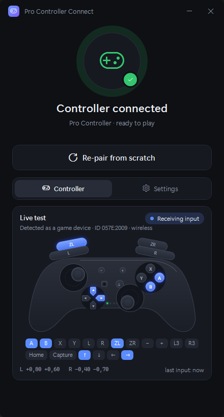
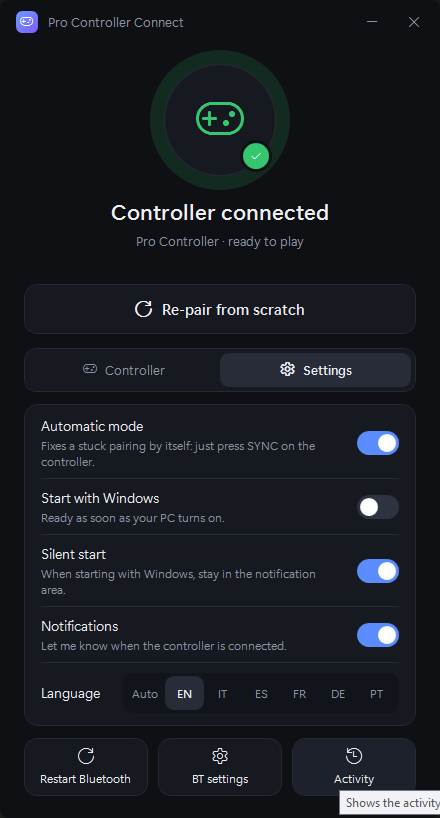

# Pro Controller Connect

[English](README.md) · **Italiano**

App per Windows che riconnette automaticamente il Pro Controller al Bluetooth del PC,
senza dover rimuovere a mano il dispositivo dalle impostazioni ogni volta.

<p align="center">
  
  
</p>

## Il problema

Dopo un periodo di inattività o un riavvio del PC, Windows mantiene un abbinamento
"bloccato" con il controller: il dispositivo risulta abbinato ma non si connette più, e
finché è in lista Windows non lo vede nemmeno quando premi SYNC. Di solito bisogna
rimuoverlo dalle impostazioni Bluetooth, riavviare la ricerca e premere di nuovo SYNC.

## Cosa fa

1. **Rimuove** il vecchio abbinamento
2. **Cerca** il controller in modalità SYNC
3. **Abbina** di nuovo, senza PIN né conferme
4. **Verifica** la connessione, anche con un **test dei tasti in tempo reale**

Inoltre:

- **Modalità automatica**: se il controller resta abbinato ma scollegato per 15 secondi,
  l'app rimuove da sola l'abbinamento e resta in ascolto. Quando vuoi giocare ti basta premere SYNC.
- **Test in tempo reale**: un controller disegnato in cui ogni tasto premuto si illumina, con
  chip di mappatura, valori degli stick e ora dell'ultimo input.
- **6 lingue**: English, Italiano, Español, Français, Deutsch, Português. "Auto" segue la lingua di Windows.
- **Avvio con Windows**, avvio silenzioso nell'area di notifica, notifiche.
- **Riavvia Bluetooth**: spegne e riaccende la radio, utile se l'adattatore si blocca.
- Registro delle attività.

## Download

Scarica `ProControllerConnect.exe` dalla pagina [Releases](../../releases), oppure compilalo
(vedi sotto).

Requisiti: Windows 10 (versione 2004) o Windows 11. Non serve installare altro: è un unico file
portatile di circa 1 MB (la finestra usa Microsoft Edge WebView2, già incluso in Windows 11).

L'eseguibile non è firmato digitalmente: al primo avvio Windows SmartScreen potrebbe mostrare
un avviso (Ulteriori informazioni › Esegui comunque).

## Uso

- **Connetti controller** avvia la procedura. Poi tieni premuto per un secondo il tasto SYNC
  (il piccolo tasto rotondo sul bordo superiore, accanto alla porta USB-C) finché i LED scorrono.
- Chiudere la finestra la nasconde soltanto. Per uscire: clic destro sull'icona nell'area di notifica › **Esci**.
- Il test dei tasti funziona quando la finestra è in primo piano (limite di Windows).

Impostazioni e log sono in `%APPDATA%\ProControllerConnect\` (`settings.json`, `log.txt`).
In `settings.json` puoi cambiare:

| Chiave | Default | Significato |
| --- | --- | --- |
| `Language` | `auto` | `auto`, `en`, `it`, `es`, `fr`, `de`, `pt` |
| `NameFilter` | `Pro Controller` | Nomi Bluetooth da gestire, separati da `;` (es. `Pro Controller;Joy-Con`) |
| `GraceSeconds` | `15` | Attesa prima della riparazione automatica |

## Compilazione

Serve [Rust](https://rustup.rs/) (toolchain MSVC).

```bash
cargo build --release
```

Il risultato è `target/release/ProControllerConnect.exe`. L'icona si rigenera con `tools/make-icon.ps1`.

## Traduzioni

Tutti i testi sono in [`src/loc.json`](src/loc.json), condiviso dall'app e dalla sua finestra. Per aggiungere
una lingua copia la tabella `en`, traducila e aggiungi il codice in `LANGUAGES` in `src/loc.rs`.
Le pull request sono benvenute.

Progetto non affiliato né approvato da Nintendo. "Pro Controller" è citato solo per indicare
il dispositivo compatibile.

## Licenza

[MIT](LICENSE)
