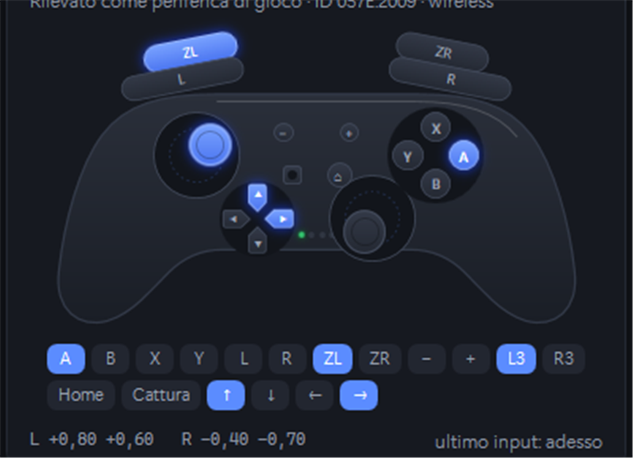

# Pro Controller Connect

App per Windows che riconnette automaticamente il Pro Controller al Bluetooth del PC,
senza dover rimuovere a mano il dispositivo dalle impostazioni ogni volta.

<p align="center">
  
  
</p>

## Il problema

Dopo un periodo di inattività o un riavvio del PC, Windows mantiene un abbinamento
"bloccato" con il controller: il dispositivo risulta abbinato ma non si connette più, e
finché è in lista Windows non lo vede nemmeno quando premi SYNC. Di solito bisogna
rimuoverlo dalle impostazioni Bluetooth, riavviare la ricerca e premere di nuovo SYNC.

## Cosa fa

1. **Rimuove** il vecchio abbinamento
2. **Cerca** il controller in modalità SYNC
3. **Abbina** di nuovo, senza PIN né conferme
4. **Verifica** la connessione, anche con un **test dei tasti in tempo reale**

Altre funzioni:

- **Modalità automatica**: se il controller resta abbinato ma scollegato per 15 secondi,
  l'app rimuove da sola l'abbinamento e resta in ascolto. Quando vuoi giocare ti basta premere SYNC.
- **Test in tempo reale**: un controller disegnato in cui ogni tasto premuto si illumina, con
  i valori degli stick e l'ora dell'ultimo input.
- **Avvio con Windows** e avvio silenzioso nell'area di notifica.
- **Riavvia Bluetooth**: spegne e riaccende la radio, utile se l'adattatore si blocca.
- Notifiche e registro delle attività.

## Installazione

Scarica `ProControllerConnect.exe` dalla pagina [Releases](../../releases), oppure compilalo
(vedi sotto). Serve Windows 10 (2004) o Windows 11 e il
[.NET 8 Desktop Runtime](https://dotnet.microsoft.com/download/dotnet/8.0).

## Uso

- **Connetti controller**: avvia la procedura. Poi tieni premuto per un secondo il tasto SYNC
  (il piccolo tasto rotondo sul bordo superiore, accanto alla porta USB-C) finché i LED scorrono.
- Chiudere la finestra la nasconde soltanto. Per uscire: clic destro sull'icona nell'area di notifica › **Esci**.
- Il test dei tasti funziona quando la finestra è in primo piano (limite di Windows).

Impostazioni e log sono in `%APPDATA%\ProControllerConnect\` (`settings.json`, `log.txt`).
In `settings.json` puoi cambiare:

| Chiave | Default | Significato |
| --- | --- | --- |
| `NameFilter` | `Pro Controller` | Nomi Bluetooth da gestire, separati da `;` (es. `Pro Controller;Joy-Con`) |
| `GraceSeconds` | `15` | Attesa prima della riparazione automatica |

## Compilazione

Serve il [.NET 8 SDK](https://dotnet.microsoft.com/download/dotnet/8.0).

```bash
dotnet publish -c Release -r win-x64 --self-contained false -p:PublishSingleFile=true -o dist
```

Per un eseguibile che non richiede .NET installato usa `--self-contained true` (file più grande).
L'icona si rigenera con `tools/make-icon.ps1`.

## Come funziona

- Bluetooth: API WinRT `Windows.Devices.Enumeration` (ricerca, abbinamento personalizzato
  "Just Works", rimozione) e `Windows.Devices.Radios` per il riavvio della radio.
- Input: `Windows.Gaming.Input.RawGameController`.
- Interfaccia: WPF (.NET 8), tema scuro, icona nell'area di notifica.

Progetto non affiliato né approvato da Nintendo. "Pro Controller" è citato solo per indicare
il dispositivo compatibile.

## Licenza

[MIT](LICENSE)
