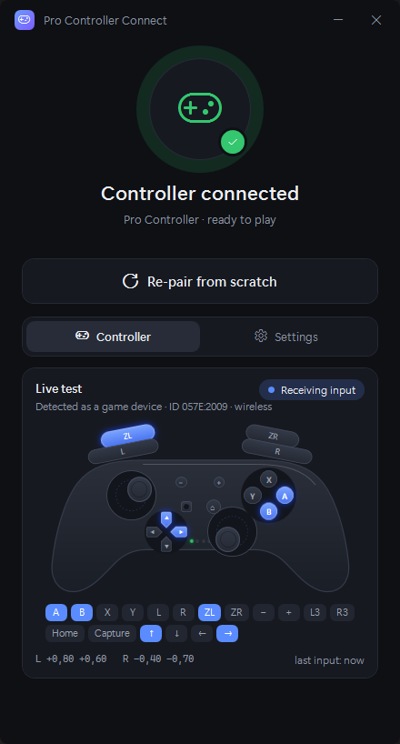

# Pro Controller Connect

**English** · [Italiano](README.it.md)

A Windows app that automatically reconnects the Pro Controller to your PC's Bluetooth,
so you no longer have to remove the device from Windows settings every time.

<p align="center">
  
  
</p>

## The problem

After a while without use, or after restarting the PC, Windows keeps a "stuck" pairing
with the controller: the device is listed as paired but never connects, and while it is
in the list Windows doesn't even see it when you press SYNC. The usual fix is to remove
it from the Bluetooth settings, search again and press SYNC once more.

## What it does

1. **Removes** the old pairing
2. **Searches** for the controller in SYNC mode
3. **Pairs** it again, with no PIN or confirmation
4. **Verifies** the connection, including a **live button test**

Also:

- **Automatic mode**: if the controller stays paired but disconnected for 15 seconds, the app
  removes the pairing by itself and keeps listening. When you want to play, just press SYNC.
- **Live test**: a drawn controller where every button you press lights up, with mapping
  chips, stick values and time of the last input.
- **6 languages**: English, Italiano, Español, Français, Deutsch, Português. "Auto" follows
  the Windows language.
- **Start with Windows**, silent start in the notification area, notifications.
- **Restart Bluetooth**: turns the radio off and on, handy if the adapter gets stuck.
- Activity log.

## Download

Get `ProControllerConnect.exe` from [Releases](../../releases), or build it yourself (see below).

Requirements: Windows 10 (version 2004) or Windows 11 and the
[.NET 8 Desktop Runtime](https://dotnet.microsoft.com/download/dotnet/8.0).

The executable isn't digitally signed, so Windows SmartScreen may warn you on first launch
(More info › Run anyway).

## Usage

- **Connect controller** starts the procedure. Then hold the SYNC button for a second (the small
  round button on the top edge, next to the USB-C port) until the lights start moving.
- Closing the window only hides it. To quit: right-click the notification area icon › **Exit**.
- The live test works while the window is in the foreground (a Windows limitation).

Settings and log live in `%APPDATA%\ProControllerConnect\` (`settings.json`, `log.txt`).
In `settings.json` you can change:

| Key | Default | Meaning |
| --- | --- | --- |
| `Language` | `auto` | `auto`, `en`, `it`, `es`, `fr`, `de`, `pt` |
| `NameFilter` | `Pro Controller` | Bluetooth names to manage, separated by `;` (e.g. `Pro Controller;Joy-Con`) |
| `GraceSeconds` | `15` | Wait before automatic repair |

## Building

Requires the [.NET 8 SDK](https://dotnet.microsoft.com/download/dotnet/8.0).

```bash
dotnet publish -c Release -r win-x64 --self-contained false -p:PublishSingleFile=true -o dist
```

Use `--self-contained true` for an executable that doesn't need .NET installed (larger file).
The icon is generated by `tools/make-icon.ps1`.

## Translations

All texts are in [`Loc.cs`](Loc.cs). To add a language, copy the English table, translate it,
and add the code to `Languages`. Pull requests are welcome.

## How it works

- Bluetooth: WinRT `Windows.Devices.Enumeration` (discovery, custom "Just Works" pairing,
  unpairing) and `Windows.Devices.Radios` to restart the radio.
- Input: `Windows.Gaming.Input.RawGameController`.
- UI: WPF (.NET 8), dark theme, notification area icon.

Not affiliated with or endorsed by Nintendo. "Pro Controller" is mentioned only to identify
the compatible device.

## License

[MIT](LICENSE)
